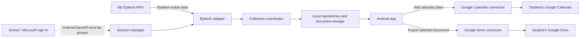

# Architecture: Epitech student companion

Date: 22 October 2026. Target: Android first. Status: M0 login implementation candidate; Android login feasibility remains unproven.

This is the implementation guide for a future coding agent. The user has authorized implementing the login feature. Current code scope is M0; document/data collection and Google integration remain later milestones. Keep the rest of the product in scope, but do not build around an authentication method that has not worked on Android.

## 1. Product purpose and confirmed requirements

Build an open-source mobile companion for Epitech students with an existing school account. It collects and centralizes the documents and data available through each student's normal school access, and provides explicit actions to export selected information to external tools. Epitech remains the source of truth.

The app complements the existing school website. Centralizing data does not require recreating every website screen or school workflow.

| ID | Confirmed requirement |
| --- | --- |
| FR-01 | Android is the first implementation and validation target. |
| FR-02 | The audience is Epitech students who already have an account. |
| FR-03 | Establish a working student login without requiring school involvement or changes to school systems. |
| FR-04 | Discover and retrieve every document the student can access on the website, across supported student-visible sources. Do not restrict collection to the personal Documents page. |
| FR-05 | Collect and centralize the other available student data: timetable, projects, deadlines, academic details, and other student-visible sections. |
| FR-06 | A student can press a button on a class to add it to Google Calendar, including its date, time and room. |
| FR-07 | A student can export an accessible document to Google Drive. |
| FR-08 | Students connect their own Google account; Google integration is optional. |
| FR-09 | Preserve the existing school's permissions. Use the signed-in student's access, including resources shared with that student. |
| FR-10 | The codebase is intended to be open source. Keep personal data, credentials and downloaded school materials out of the public repository. |
| FR-11 | Validate login first, before implementing collection and Google features. |
| FR-12 | Do not silently drop previously discussed features when narrowing the first milestone to login. |

Reading broad directory endpoints or guessing other students' identifiers is not the meaning of "every data available." The collection boundary is the signed-in student's normal website experience, including authorized shared course resources.

## 2. Decision ledger

Separate the user's requirements from architecture defaults and unresolved choices.

| Decision | Status | Direction |
| --- | --- | --- |
| Android first, Epitech accounts, no school involvement | Confirmed | Required constraints. |
| Google Calendar and Google Drive | Confirmed | First two external integrations. |
| Epitech access from the app | Architecture default | Read school data; authentication is the necessary exception. School-side actions open the existing website. |
| Mobile stack | Proposed baseline | React Native, TypeScript and Expo development builds; allow a small native Android adapter where identity SDKs require it. |
| Data location | Proposed default, not explicitly chosen by user | On the student's device; no application backend or separate app account for the first release. |
| Document bytes | Proposed default | Index all discovered documents; fetch bytes on open, download, offline save or export. Provide user-initiated batch retrieval. |
| Export behavior | Proposed default; user has not settled update policy | Manual exports and manual updates. Keep the mapping needed for later automatic updates. |
| Background operation | Proposed default | Refresh on launch/resume and user request; background work is optional and best effort. |
| Cross-device synchronization | Unresolved / outside first release | Do not introduce a server or cloud backup implicitly. |
| iOS | Future possibility | Keep domain code portable; no current requirement to deliver iOS. |
| Other tool integrations | Future extension | Do not implement Notion, Todoist, direct GitHub linking or other connectors without a later requirement. |
| Open-source license and app name | Unresolved | Set before public release; do not invent school endorsement or branding. |

Use proposed defaults to write coherent code once implementation is authorized. Record a decision and its reason when changing one; do not turn these defaults into claims that the user explicitly selected them.

## 3. Existing evidence and its limits

The planning workspace already contains:

- `outputs/epitech-api-catalog.md`: readable endpoint inventory.
- `outputs/epitech-api-endpoints.json`: methods, route alternatives, parameters, types and source references.
- `outputs/epitech-api-sources.zip`: downloaded public frontend evidence.
- `work/recovered-src/`: investigative source-map extraction; scratch material, not app source.
- `work/login-check/redirect-results.json`: anonymous configuration checks, if retained.

Keep the first three files with this guide when handing the task to another agent. In a future app repository, put the useful evidence under `docs/api/` and update references. Do not publish the entire downloaded school frontend as application code.

Observed frontend release: `3.65.0`. Observed API base: `https://my.epitech.eu/api`. The inventory contains 644 request/URL definitions in 55 groups. It includes staff and administrative code as well as student code. Its counts are not a list of routes this app should call.

| Finding | Evidence level |
| --- | --- |
| Website uses Microsoft sign-in and exchanges an ID token through `/auth/token` | Public frontend source. |
| Epitech exposes application access/refresh token handling, `/auth/verify`, and `/auth/refresh` | Public frontend source; refresh has not been independently proven in our Android app. |
| Dashboard, academic details, planning, projects, e-learning and units rendered after user sign-in | Authenticated desktop browser UI observation. |
| Every catalog endpoint is accessible or current | Not established. |
| Epitech accepts a Microsoft token issued to an independently registered app | Not established. |
| A native Android app can receive a usable Epitech session without school changes | Not established. |
| Anonymous callback checks proved a native callback works or fails | Not established. Both checks encountered `AADSTS50058` / missing login; they were inconclusive. |

Source maps describe client expectations. Validate response shapes and behavior against actual student access before relying on them. Do not claim Android login works because the website loaded, an anonymous request returned HTTP 200, or a mocked test passed.

## 4. System shape



Use one mobile application with clear module boundaries. A monorepo, API gateway, job server, hosted database and microservices are unnecessary for the initial scope.

Dependency direction:

`Screens -> application use cases -> domain contracts -> provider/storage adapters`

Screens must not construct Epitech URLs, interpret raw API responses, handle refresh tokens, or call Google APIs directly. Provider-specific details stay behind adapters. Persisted local data is the display source; collection updates it and UI observers refresh accordingly.

## 5. Technology baseline

Use this baseline after the login investigation supports it:

| Concern | Baseline |
| --- | --- |
| Mobile UI | React Native with TypeScript. |
| Build/runtime | Expo development build, with native Android configuration available. Do not require Expo Go for authentication validation. |
| Navigation | Expo Router or the existing repository's navigation solution. |
| Durable structured data | SQLite via `expo-sqlite`, versioned migrations, account-scoped repositories. |
| Database protection | SQLCipher in the native build; database key kept in protected device storage. Verify `PRAGMA cipher_version` before treating the database as encrypted. |
| Tokens and encryption keys | `expo-secure-store` or a native equivalent backed by Android Keystore. |
| Files | App-private storage, per-account directories, streaming transfers and explicit retention controls. |
| Remote contracts | Independently authored TypeScript models plus runtime response validation. |
| Transient UI state | Component state and small stores only where necessary. Do not duplicate the durable database in a global state store. |
| Search | SQLite full-text search for metadata and supported text content; no AI service required. |
| Google authorization | A maintained native Android integration using Google's current authorization APIs, isolated behind a connector adapter. |

Choose mutually compatible stable package versions at implementation time and commit a lockfile. Do not copy version numbers from this document. If the proven login approach requires native code, add an Android identity adapter; explain the constraint before replacing the entire stack.

SQLCipher is not available in Expo Go. Setting a database key without checking that the built binary contains SQLCipher must not silently produce an unencrypted database. Tokens belong in protected storage, not SQLite, AsyncStorage or logs. SQLCipher does not encrypt document files; those remain in app-private storage under Android's platform protection. Do not advertise separate application-level file encryption unless it has actually been implemented and tested.

Suggested source layout, to be created only during authorized implementation:

```text
architecture.md
app/                         navigation and screen composition
src/
  domain/                    provider-independent models and contracts
  application/               collect, search, download and export use cases
  features/
    auth/
    home/
    documents/
    timetable/
    academic/
    connections/
    settings/
  providers/
    epitech/                 auth strategies, transport, schemas, collectors
    google/                  authorization, calendar and Drive adapters
  storage/                   database, migrations, repositories, file store
  jobs/                      durable collection/download/export jobs
  platform/                  Android-specific identity and lifecycle bridges
  shared/                    errors, time handling and redacted diagnostics
  test-support/              synthetic fixtures and fake adapters
modules/                     native Android adapters only if needed
docs/
  api/                       curated endpoint evidence
  decisions/                 architecture decisions
  validation/                sanitized milestone evidence and coverage ledger
```

## 6. First milestone: prove Epitech login on Android

### 6.1 Known website flow

The recovered client follows this sequence:

1. Open Microsoft sign-in for the school's registered application.
2. Receive a Microsoft ID token in the website's login flow.
3. Send `POST /auth/token` with that ID token in the bearer header.
4. Receive Epitech `access_token` and `refresh_token` values.
5. Call `GET /auth/verify` with the Epitech access token.
6. Renew through `POST /auth/refresh` with a JSON `refresh_token` field when required.

The observed website callback is `https://my.epitech.eu`. Its published client and tenant identifiers are configuration, not secrets, and do not confer ownership of the school's application registration.

The separate `/auth/external` email/password flow exists in source. It has not been shown to accept ordinary student Microsoft credentials. Do not build a school-password form around that assumption.

### 6.2 Authentication strategies to investigate

Keep login behind an `EpitechAuthAdapter` so that the rest of the app does not depend on a guessed strategy.

Evaluate these candidates rather than declaring either operational:

- **Independent native OAuth application:** determine whether the student's tenant permits the flow, whether an app-owned callback can be registered, and whether Epitech accepts the resulting token's audience. A successful Microsoft sign-in alone is insufficient.
- **Official-portal session integration:** determine whether Android can complete the real portal login and expose the student's resulting Epitech session to the app through a deliberate, on-device, origin-bound integration. This requires a separate feasibility and security assessment. A system browser or Custom Tab does not automatically expose its page storage to an app; an embedded container may behave differently or fail the login requirements.

Use the normal school/Microsoft sign-in experience, including MFA. Do not impersonate ownership of the school registration, assume a new redirect is allowed, weaken TLS, bypass authentication controls, proxy password entry, read another app's private browser storage, or use copy/paste tokens as the final user experience.

If a portal bridge is evaluated, it must not read password fields or inject a bridge into Microsoft credential pages. Any session transfer must be limited to the intended authenticated school origin and the student's device, with an explicit connection action. Do not send school session tokens to an application-owned server. Do not ship a bridge merely because it appears technically possible; prove that its login behavior and origin checks are sound.

If neither strategy meets the no-school-involvement constraint, report the exact unresolved dependency. Do not hide it behind a mock login or continue presenting the app as viable under unchanged requirements.

### 6.3 Session contract and lifecycle

The session manager owns `connect`, `restore`, `ensureValidSession`, `disconnect` and expiry handling. UI code receives a verified account identity and connection status, never raw token values.

States: `disconnected`, `connecting`, `connected`, `refreshing`, `reauthentication_required`, and recoverable `error`.

Requirements:

- Determine the account from the verified school session, not an email suffix or a typed identifier. Confirm the verified account has the student role; staff-only sessions are outside this app's audience.
- Support one active Epitech account initially; isolate all stored data and pending work by verified account.
- Store provider credentials only in protected storage. Persist access/refresh token rotations safely, and serialize refresh requests so concurrent API calls cannot race token rotation.
- Retry a failed authenticated read at most once after a successful refresh. Avoid infinite refresh loops.
- Treat network failures and server failures differently from an invalid or revoked session.
- Persist the connection through application restart when the provider permits it.
- Local disconnect clears app-held credentials, sensitive cached data and account-specific work. Do not claim that local disconnect revokes server tokens or signs the user out of Microsoft globally unless a verified provider operation actually does so.
- A provider response arriving after disconnect/account switch must not write into the new account's storage. Use a session generation/cancellation boundary.

### 6.4 Login acceptance criteria

When login implementation is later authorized, use a real Android device or representative Android runtime and a consenting student account. Record sanitized pass/fail evidence for:

1. Fresh connection through the intended Android flow; cancellation also returns cleanly.
2. Normal MFA completion if the account requires it.
3. Acquisition of a usable Epitech session, followed by successful `/auth/verify` and a minimal read of the student's own profile.
4. The verified student identity matches the account that completed login.
5. Closing and reopening the app restores the intended connection.
6. Refresh works, including rotation where applicable, and an authenticated read succeeds afterwards. A restart test is not a substitute for a refresh test.
7. Expired/revoked sessions request sign-in again without exposing another account's cached data.
8. Disconnect clears the app's local session. Tokens are absent from logs, screenshots, fixtures and the repository.

If natural expiry cannot be exercised during the test, label refresh as pending; do not fabricate evidence. Do not alter device clocks or provider configuration to manufacture success. A fake adapter may test application behavior but cannot satisfy this milestone.

The deliverable for this milestone is a short login decision record, the selected adapter, reproducible setup instructions, and actual Android validation evidence. Do not build document or Google screens before this gate passes. If the future user request is specifically login-only, remain within that milestone.

## 7. Student data collection and coverage

Implement a collection registry. Each collector declares its source, required account context, pagination/discovery behavior, normalized record types, download capabilities and current coverage status.

| Source category | Required coverage |
| --- | --- |
| Personal documents | All documents visible to the student, including administrative files, transcripts/reports and their permitted downloads. |
| Unit resources | Student-visible unit descriptions, resources, files, folders and links across accessible school years and instances. |
| Activity and project resources | Briefs, attachments, related resources, project metadata, deadlines and the student's registration information. |
| E-learning | Accessible modules, chapters, textual content, downloadable files, subtitles and external references where exposed. Do not claim that a streaming URL is a downloadable document. |
| Timetable | Classes, rooms, instructors, relevant dates, registration state and individual appointment slots where available. |
| Academic data | Own profile, curriculum/semesters, grades, evaluations, competencies, exams, attendance/absence information and log time available to the student. |
| Other student-visible data | Own notifications, follow-ups, placements, badges/XP and similar sections where available. Provide collected data/details without recreating the school's management workflows. |
| External platform links | Preserve the source and link. Mark separate-login or unsupported content explicitly; do not pretend it was downloaded. A different platform may need a future connector. |

Collection must discover every supported accessible item, not just the first page or the current term. Load useful current information first, then work through the remaining accessible sources with bounded jobs. Display progress and coverage rather than making onboarding wait for a complete historical crawl.

Maintain a coverage ledger with: category, source page, collector, endpoint evidence, supported record types, last successful validation, and status. Use statuses such as `planned`, `validated`, `partial`, `link_only`, `unavailable_for_account` and `unsupported`. Unavailable for one account does not prove unavailable for all students.

"All documents supported" may be claimed only after a source-by-source comparison with the student's portal, including nested folders, pagination and historical resources. Provide a visible explanation for each remaining gap. Preserve the full-coverage goal through the milestones.

### 7.1 Starting API evidence

These are source-derived candidates, not guarantees. Paths are relative to `https://my.epitech.eu/api`.

| Purpose | Candidate operation |
| --- | --- |
| Establish / verify / renew session | `POST /auth/token`, `GET /auth/verify`, `POST /auth/refresh` |
| Own profile | `GET /students/profile` |
| Own document index | `GET /students/documents` |
| Fresh download URL | `GET /students/documents/{documentId}/download` |
| Own evaluations, marks and assessments | `GET /students/evaluations`, `/students/evaluations/marks`, `/students/evaluations/assessments` |
| Own exams and log time | `GET /students/exams`, `GET /students/logtime` |
| Own follow-ups and placements | `GET /students/follow-ups`, `GET /students/placements` |
| Own project absence summaries | `GET /students/absences/projects` |
| Planning | `GET /events` and item detail `GET /events/{id}` |
| Own event registration | `GET /events/{eventId}/registrations/me` |
| Accessible unit instances | `GET /units/instances` plus their permitted detail/resources |
| Project instances | `GET /units/instances/projects` plus permitted project detail/resources |
| E-learning | `GET /e-learning/overview`, `/e-learning/modules/{id}` and chapter operations in the inventory |
| Own notification feed | `GET /notifications/feed` |
| Own XP | `GET /gamification/xp/me` |

Prefer account-relative routes where provided. Some read operations require the verified account identifier; supply that identity deliberately rather than accepting arbitrary login values from UI input.

The generic file client receives a source URL at runtime. The recovered helpers describe families such as `/{resourceEndpoint}/{resourceId}/files/students` and `/units/instances/projects/{projectInstanceId}/related-resources/files`. Verify the actual source configuration before using them; do not substitute guessed route families. Staff storage is outside the collection scope.

## 8. Transport and collection rules

The Epitech adapter owns authentication headers, URL construction, response validation and conversion into domain models. Use a small explicit operation allowlist. Authentication writes are allowed; school-side mutations such as registration, attendance submission, notification dismissal and document upload are outside this product's initial behavior.

- Derive cursors and termination rules from each response; paginate until complete and detect repeated cursors or other loops.
- Use bounded concurrency and bounded backoff. Honor `Retry-After`; avoid request storms on app resume or repeated auth failures.
- Check cancellation before requests and before committing results.
- A failed page or source must not erase already collected data or make the whole collection appear complete.
- Keep per-source checkpoints and last-success timestamps. Do not infer deletion from partial pagination or a temporary error.
- Hide/disable items with confirmed revoked access. Distinguish this from offline or transient failures; do not continue exporting an item after a known access denial.
- Validate response shapes at adapter boundaries. Keep malformed sections visible as a source problem rather than crashing the app or silently discarding fields.
- Use account-qualified stable source identifiers. A numeric document or event ID alone is not a global identifier.
- Preserve source links and provenance on records so students can open the corresponding school page.
- Reading notifications must not automatically dismiss or mark them as seen on the school service.

The API inventory is a research aid. Do not sweep its 644 definitions against a logged-in account. Add only the student operations a collector has justified.

## 9. Local data and document storage

Use account-scoped repositories over a migrated local database. The following model is a design contract; exact table names may change while preserving the semantics.

| Model | Important fields / responsibility |
| --- | --- |
| Account | Verified school identity, authority/API origin, display metadata and active session generation; no tokens. |
| Source | Collector ID, source kind, parent/context, coverage state, checkpoint, last attempt/success and last recoverable error. |
| SchoolRecord | Account + source + remote ID, kind, normalized fields, source link, source update/version marker, first/last observed timestamps and access state. |
| Document | Stable identity, name, MIME type, size when known, source/parent folder, unit/project/year context, remote version, download state and local blob reference. |
| Event | Remote event/occurrence identity, title, start/end instants, timezone, rooms, instructors, campus and optional personal slot. |
| LocalBlob | App-private path, size, checksum, source version, temporary/pinned state and last use. |
| Connection | Provider, selected provider account identity/handle, granted capabilities and status; provider credentials stay in protected storage. |
| ExportMapping | School account + source identity + provider account + destination, remote item ID, exported source version/hash and last successful export. |
| Job | Account, operation kind, durable idempotency/correlation key, payload references, state, attempts, retry time, progress and cancellation state. |

Store generic normalized record payloads for less prominent student data, with typed projections for documents and events. This allows broad data coverage without building a separate feature application for every portal section. Index searchable metadata; full document-text extraction is incremental and must advertise supported formats.

Document behavior:

1. Discover and index the document, its context and source identity.
2. Resolve a fresh download URL when bytes are needed; download links may expire.
3. Stream the file to a temporary app-private location, validate the completed transfer, then finalize the local reference.
4. Open, save offline, or stream onward to the selected Google destination.
5. Keep user-pinned offline files until the student removes them or disconnects the account. Manage temporary files with a bounded cache policy.

Provide selection and batch actions, including retrieval/export of all discovered accessible documents in a selected scope. Show counts and known sizes, progress, per-item failures and cancellation. Unknown sizes must remain unknown until measured. Do not load entire large files into JavaScript memory.

A signed object-storage URL is not the same origin as the school API. Validate expected HTTPS download destinations and redirect behavior; do not forward Epitech bearer headers or refresh tokens to object storage or to Google. Treat an expired download URL as a reason to obtain a fresh URL before assuming the account itself is invalid.

Default metadata storage is local. Ordinary offline mode may show previously collected data and pinned files with a stale indicator. It cannot fetch new school data or complete a Google upload without connectivity. Disconnect/account changes must clear or isolate every cache, file, job and export mapping.

## 10. Google account connections

Epitech connection and Google authorization are independent. A student can browse collected school data without granting Google access. Google sign-in is not a substitute for verifying an Epitech student session.

Use Google's current Android authorization integration through the Google provider adapter. Request Calendar access when the student first uses the calendar action, and Drive access when first exporting a file. Register an app-owned Android client with the correct package/signing identities during later setup; do not reuse the school's Microsoft registration for Google integration.

Do not apply a desktop localhost OAuth recipe to Android. Do not use a password form or an embedded Google login page. Do not assume the Android SDK will hand the application a raw refresh token; use its documented token acquisition/renewal contract. Persist only what the chosen supported SDK requires.

Recommended initial capability boundaries:

| Capability | Proposed permission scope / behavior |
| --- | --- |
| Calendar exports | A dedicated calendar created by the app, using `calendar.app.created` if supported by the selected integration. |
| Drive exports | Files/folders created or explicitly opened for the app, using `drive.file`. |
| Personal Google content | No broad Drive scan or unrelated personal calendar import in the initial scope. |

If the user later requests exporting to arbitrary existing calendars or folders, choose the documented permissions and selection mechanism for that feature. Do not add broad permissions preemptively. Provider cancellation, denied permission, account changes and revoked grants must leave core school browsing usable.

Each export must identify its actual Google account and destination. Switching provider accounts cannot reuse mappings from the previous account. Disconnect cancels pending jobs for that connection; removing a connection does not silently delete files or calendar events that were already exported.

## 11. Add a class to Google Calendar

Required example: a student sees a class at 13:00 in room 601, taps **Add to Google Calendar**, and receives a correctly dated event with room 601 as its location.

Workflow:

1. Read the selected normalized event and its latest known source version.
2. Resolve the linked Google account and destination calendar, requesting the missing capability if needed.
3. Display the event's title, date/time, room and destination in its detail/action context. An intentional tap is the export request; do not require a repetitive confirmation for every normal export after setup.
4. Create a durable export job and correlation key before sending the provider write.
5. Create the event, or offer/update the corresponding existing export according to the snapshot policy below.
6. Persist the provider item ID and exported source version. Show **Added**, **Update available**, progress or an actionable failure as appropriate.

Map title, start/end, room(s), campus, relevant instructors and a source link. For an individually assigned defense/appointment slot, prefer the student's own slot times when available; do not export the entire multi-hour session as that student's appointment.

Keep actual instants and the appropriate source IANA timezone. Do not hardcode Europe/Paris for every campus, use the developer machine timezone, or convert all-day dates into midnight timed events. Test daylight-saving transitions.

Idempotency must survive repeated taps, retries and an interrupted process. Use a stable source identity plus provider account/destination, and a recoverable provider-side correlation marker or a documented deterministic ID strategy. If the remote write may have succeeded, reconcile it before retrying; a local mapping saved only after success is insufficient.

Initial update policy is manual: changes to school time, room or title become **Update available** on previously exported items. Repeated taps must not silently create duplicates. Automatic ongoing calendar synchronization and changes back to Epitech are not yet confirmed features. Source cancellation/removal must be shown clearly; do not automatically delete an exported event under the initial snapshot policy.

## 12. Export documents to Google Drive

Required behavior: a student selects a document they can access, taps **Export to Google Drive**, and receives the original file in their connected Google Drive.

Workflow:

1. Resolve the document's current identity, access state and version.
2. Resolve the connected Google account and app-created destination folder. Default organization may be `Epitech / school year / unit or project`; documents lacking that context still get a sensible destination.
3. Obtain a fresh school download URL, or use a valid completed cached copy of the same version.
4. Stream the original file, preserving its filename, MIME type and bytes. No Google Docs conversion is required.
5. Upload using an appropriate resumable transfer for large files; report progress, cancellation and recoverable failures.
6. Save a mapping between source document/version and the created Drive file. Retrying or tapping twice must not create unintended copies.

As with calendar exports, persist a job/correlation key before the write and use provider metadata/reconciliation to recover an uncertain success. Do not blindly retry a non-idempotent upload after a timeout. Test the failure between remote success and local mapping persistence.

A source document changing later must not silently overwrite the student's Drive copy. Default to an explicit **Update export** action. If the destination was edited independently, show a conflict and let the student keep the copy, update it or create a new copy deliberately. Batch exports use the same per-document rules and can finish partially without misreporting full success.

Do not expose files publicly or change sharing permissions as part of export. An exported Google file is an intentional independent copy: local logout or later school access loss does not promise its removal from Google Drive.

## 13. Mobile experience and lifecycle

The full product can use these main areas after login feasibility is proven:

- **Connect Epitech:** clear connection state, normal sign-in, cancellation and recovery.
- **Home:** useful current classes/deadlines, recent documents and freshness/collection progress.
- **Documents:** unified sources, search, filters, folder/context, previews where supported, download/offline controls and Drive actions.
- **Timetable:** classes and personal appointments, date/time/room details and the Calendar action.
- **School data:** searchable collected academic/project/other records with provenance and links to the website.
- **Connections and settings:** Google capabilities, selected destinations, storage, pending exports, refresh status, disconnect and local data removal.

Screen content should speak in student terms. Keep endpoints, OAuth tokens, database tables and internal collector names in developer diagnostics, not routine product flows. Provide loading, empty, unavailable, partial, stale, disconnected and retry states; never disguise unsupported content as an empty account.

On launch/resume, show cached data first and schedule appropriate refreshes. Manual refresh should be available. Android may defer or stop background work; do not promise continuous collection while the app is closed. A future opt-in background refresh can reuse the job interfaces without introducing a server or automatic exports by accident.

## 14. Jobs, errors and observability

Use a durable job state model: `queued`, `running`, `succeeded`, `failed`, `cancelled`, and `waiting_for_connection` where needed. Checkpoint long collections, downloads and uploads. Prevent two workers from performing the same export concurrently. Cancelled jobs must not restart automatically after app restart.

Distinguish these outcomes in domain errors:

- Connectivity / temporary provider failure: retain data, schedule a bounded retry.
- Authentication expired: refresh once or request reconnection.
- Permission denied or item access revoked: explain the source limitation; do not escalate access.
- Malformed/changed school response: record a redacted contract failure and keep unaffected sources usable.
- Expired signed download link: renew the link.
- Google authorization missing/revoked: reconnect that capability without logging out of Epitech.
- Uncertain external write result: reconcile before retrying.
- Storage full or interrupted transfer: preserve a recoverable state and remove unusable temporary files safely.

Logs must omit bearer headers, tokens, cookies, password values, signed URLs and raw private response bodies. Log operation names, sanitized status/error categories and correlation IDs. Produce diagnostic summaries that can be shared in open-source issues without including student records. Production telemetry is not required for the first release.

## 15. Tests and evidence

Test behavior that can lose data, misrepresent access or create duplicate external actions. Do not add tests that merely mirror implementation details.

| Area | Required verification |
| --- | --- |
| Android login | All real-account criteria in section 6, separately from fake-adapter tests. |
| Session handling | Serialized refresh, rotation, network failure versus invalid session, process restart and account-switch races. |
| Collection | Nested resources, all pagination, repeated cursors, partial failures, schema changes and correct freshness/coverage reporting. |
| Account isolation | Cached data, in-flight results, downloads, Google mappings and queued exports cannot cross school accounts. |
| Documents | Expired URLs, streamed large transfers, storage pressure, cancellation, duplicate names, version changes and safe credential-free object-storage requests. |
| Local database | Migrations retain data; encryption availability is verified in the native build; interrupted transactions recover. |
| Calendar | Correct date/time/room, personal appointment slot, timezone/DST, repeated taps, retries, remote-success/local-failure recovery and manual update behavior. |
| Drive | Byte-preserving export, filename/MIME, interrupted uploads, uncertain success recovery, batch partial failure and intentional version updates. |
| Google capability handling | Declined consent, cancelled authorization, wrong/changed account, revoked access and core browsing without Google. |
| Offline/lifecycle | Cached content is labeled correctly; jobs resume/cancel accurately; unsupported background execution is not promised. |

Use synthetic fixtures for automated tests and development screenshots. For live Google validation, use a deliberate test calendar/folder and test items in a consenting account. Publishing the repository must not publish downloaded coursework, administrative documents or private response fixtures.

## 16. Implementation sequence and completion gates

| Milestone | Scope | Exit condition |
| --- | --- | --- |
| M0: Android login feasibility | Minimal authorized login test, session manager and a single own-profile read; no general app screens. | Real Android login/session evidence passes, or a precise unresolved dependency is documented. |
| M1: Local foundation | App shell, account-scoped repositories, protected credentials, encrypted database, job model and first collectors. | Restart, isolation, migration, failure and refresh behavior verified. |
| M2: Centralized data and documents | Source registry, broad student-data collection, searchable document index, individual/batch retrieval and offline files. | Coverage ledger reconciled against portal sources; remaining gaps explicit, with actual supported downloads demonstrated. |
| M3: Calendar export | Optional Google capability, selected-class export, mappings, duplicate prevention and manual updates. | The 13:00 / room 601 scenario and duplicate/recovery/timezone cases pass. |
| M4: Drive export | Original-file export, folders, progress, batch behavior, mappings and explicit updates. | Original bytes reach the intended account/folder; interrupted/repeated exports recover without unintended copies. |
| M5: Coverage and release readiness | Remaining student-visible source coverage, mobile polish, setup/contributor documentation and license decision. | Requirements below are traceable to evidence; open gaps are accurately reported before any public release. |

M0 is a dependency, not a substitute for the rest of the product. A login proof alone is not a completed companion app. Likewise, a personal-documents-only importer does not fulfill the all-accessible-documents requirement.

| Requirement | Primary evidence / milestone |
| --- | --- |
| FR-01, FR-02, FR-03, FR-11 | M0 Android student identity and session validation. |
| FR-04 | M2/M5 source-by-source document coverage, all pages/folders and actual individual/batch retrieval. |
| FR-05 | M2/M5 normalized student data and coverage ledger. |
| FR-06 | M3 selected-class Calendar export. |
| FR-07 | M4 document Drive export. |
| FR-08 | M3/M4 optional, independently connected Google account and denied-consent handling. |
| FR-09 | Collector allowlist, account-relative access, isolation and permission-failure tests. |
| FR-10 | M5 public-repository hygiene, chosen license and contributor/setup instructions. |
| FR-12 | This traceability table and milestone completion reports. |

Each coding-agent handoff should state: completed milestone, real versus mocked evidence, files changed, checks run, remaining coverage gaps and the next permitted milestone. Update this guide when a decision or proven provider constraint changes; preserve the confirmed requirements.

## 17. Boundaries and open decisions

These are outside the initial implementation unless the user later requests them:

- School-side editing, registration, attendance submission or administrative operations.
- Two-way synchronization back to Epitech.
- Automatic continuous Google exports or overwrites.
- Importing unrelated personal Google Drive files or personal calendar events.
- A hosted backend, separate application accounts, cross-device backup or permanent server storage of school data.
- AI summaries/chat, direct integrations with tools beyond Calendar and Drive, and iOS delivery.

Still open: working Android authentication strategy, long-term export update behavior, cross-device storage expectations, final app name, license and any future iOS scope. Settle an open decision when it affects the current milestone; unrelated choices must not delay login investigation.

## 18. Primary references

These support provider constraints and proposed infrastructure. Recheck current documentation during implementation; they do not prove that a particular Epitech tenant/application supports our desired flow.

- [Microsoft redirect URI restrictions](https://learn.microsoft.com/en-us/entra/identity-platform/reply-url): callbacks belong to registered application configuration.
- [Microsoft ID-token claims](https://learn.microsoft.com/en-us/entra/identity-platform/id-token-claims-reference): token audience is significant; do not assume another application's token is accepted.
- [Microsoft Android browser/WebView behavior](https://learn.microsoft.com/en-us/entra/msal/android/customize-browsers-and-webviews): native authentication containers differ.
- [Android Google data authorization](https://developer.android.com/identity/authorization): separate feature authorization and request it when needed.
- [Google Calendar permissions](https://developers.google.com/workspace/calendar/api/auth): app-created-calendar capability and alternatives.
- [Google Drive permissions](https://developers.google.com/workspace/drive/api/guides/api-specific-auth): per-file access for uploads and app-managed files.
- [Expo SecureStore](https://docs.expo.dev/versions/latest/sdk/securestore/): protected local credential storage and platform limitations.
- [Expo SQLite / SQLCipher](https://docs.expo.dev/versions/latest/sdk/sqlite/): native database encryption configuration and availability checks.

The local API catalog and source references remain the Epitech-specific evidence. Actual authenticated Android validation remains the outstanding first gate.
