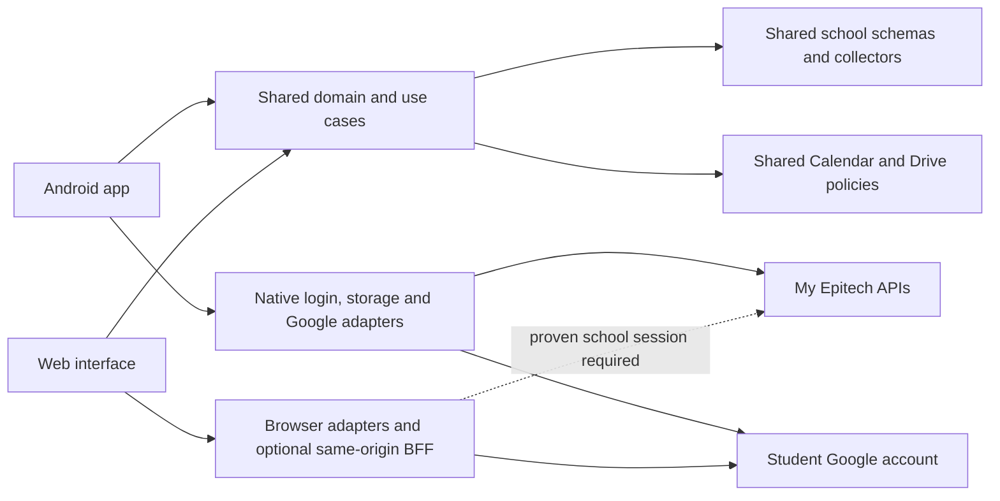

# Architecture: Epitech mobile and web companion

Updated: 23 October 2026. Targets: Android mobile and web, maintained together on `main`. Status: Android implementation candidate; experimental web foundation implemented; school web login unproven.

This guide covers both versions of Better MyEpitech. The user has requested a shared repository containing mobile and web apps, shared business logic, and independent releases. The subsequent user request authorizes web implementation. The first slice adds a separately buildable web workspace and a configurable experimental sign-in adapter; deployment and authenticated release still require the W0 evidence below.

The existing Android project includes school login, projects/deadlines, timetable collection and optional Google Calendar export candidates. The projects/calendar work is merged into `main`; 167 synthetic tests, Android bundling and native Android compilation passed. Real Android school login/MFA/refresh, live API coverage, configured Google authorization and live exports remain pending. Web login has not been established. Shared code and passing Android builds do not prove browser feasibility. Document collection and Google Drive remain required roadmap features for both platforms.

## 1. Product purpose and confirmed requirements

Build an open-source companion with Android mobile and web versions for Epitech students with an existing school account. It collects and centralizes the documents and data available through each student's normal school access, and provides explicit actions to export selected information to external tools. Epitech remains the source of truth.

The app complements the existing school website. Centralizing data does not require recreating every website screen or school workflow.

| ID | Confirmed requirement |
| --- | --- |
| FR-01 | Android remains the first mobile implementation and validation target; a web version is also planned. |
| FR-02 | The audience is Epitech students who already have an account. |
| FR-03 | Establish a working student login without requiring school involvement or changes to school systems. |
| FR-04 | Discover and retrieve every document the student can access on the website, across supported student-visible sources. Do not restrict collection to the personal Documents page. |
| FR-05 | Collect and centralize the other available student data: timetable, projects, deadlines, academic details, and other student-visible sections. |
| FR-06 | A student can press a button on a class to add it to Google Calendar, including its date, time and room. |
| FR-07 | A student can export an accessible document to Google Drive. |
| FR-08 | Students connect their own Google account; Google integration is optional. |
| FR-09 | Preserve the existing school's permissions. Use the signed-in student's access, including resources shared with that student. |
| FR-10 | The codebase is intended to be open source. Keep personal data, credentials and downloaded school materials out of the public repository. |
| FR-11 | Validate login and report its evidence accurately. The 23 October authorization permits project/timetable and Calendar implementation in parallel with pending interactive validation. |
| FR-12 | Do not silently drop previously discussed features when narrowing a milestone or adding a platform. |
| FR-13 | Provide a web version with the same student-data/document and export goals, subject to separately proven browser capabilities. |
| FR-14 | Maintain both apps and their shared packages in the same repository and `main` branch; release them independently. |
| FR-15 | Share domain models, collection rules and export policies; isolate platform-specific UI, login, storage and runtime integrations. |
| FR-16 | Use descriptive branch names such as `docs/mobile-web-architecture`, `feat/web-login` or `fix/calendar-export`; do not use the `codex/` prefix. |

Reading broad directory endpoints or guessing other students' identifiers is not the meaning of "every data available." The collection boundary is the signed-in student's normal website experience, including authorized shared course resources.

## 2. Decision ledger

Separate the user's requirements from architecture defaults and unresolved choices.

| Decision | Status | Direction |
| --- | --- | --- |
| Android first, web target, Epitech accounts, no school involvement | Confirmed | Required constraints; web login feasibility is a separate gate. |
| Google Calendar and Google Drive | Confirmed | First two external integrations. |
| Epitech access from the app | Architecture default | Read school data; authentication is the necessary exception. School-side actions open the existing website. |
| Mobile stack | Existing baseline | React Native, TypeScript and Expo development builds, including a local native Google authorization module. |
| Shared repository | Confirmed direction; migration not implemented | `apps/mobile`, `apps/web`, `packages/core`, `packages/epitech`, `packages/google` on `main`. |
| Web stack | Proposed baseline | React and TypeScript; consider Next.js if same-origin server routes are required. Select the framework/deployment target after the web login feasibility decision. |
| Workspace tooling | Proposed baseline | npm workspaces and the existing lockfile; avoid introducing a build orchestrator without a demonstrated need. |
| Mobile data location | Default | Device-local data and protected native credentials; no mobile backend required by the current candidate. |
| Web session/transport | Unresolved; conditional proposal | Prefer a same-origin backend-for-frontend (BFF) if server custody of tokens or server-side transport is needed. It does not solve school login by itself. |
| Web retention | Proposed minimum | Session-bound data and explicit retention; no permanent hosted school archive or separate app account by default. |
| Document bytes | Proposed default | Index all discovered documents; fetch bytes on open, download, offline save or export. Provide user-initiated batch retrieval. |
| Export behavior | Proposed default; user has not settled update policy | Manual exports and manual updates. Keep the mapping needed for later automatic updates. |
| Background operation | Proposed default | Refresh on launch/resume and user request; background work is optional and best effort. |
| Cross-device synchronization | Unresolved / outside initial scope | A shared repository does not synchronize phone/browser data, sessions or export destinations. A web session service is not authorization for a cross-device archive. |
| iOS | Future possibility | Keep domain code portable; no current requirement to deliver iOS. |
| Other tool integrations | Future extension | Do not implement Notion, Todoist, direct GitHub linking or other connectors without a later requirement. |
| Open-source license and public branding | Unresolved | Better MyEpitech is the current working name; choose a license before public release and do not imply school endorsement. |

Use proposed defaults to write coherent code once implementation is authorized. Record a decision and its reason when changing one; do not turn these defaults into claims that the user explicitly selected them.

## 3. Existing evidence and its limits

The planning workspace already contains:

- `outputs/epitech-api-catalog.md`: readable endpoint inventory.
- `outputs/epitech-api-endpoints.json`: methods, route alternatives, parameters, types and source references.
- `outputs/epitech-api-sources.zip`: downloaded public frontend evidence.
- `work/recovered-src/`: investigative source-map extraction; scratch material, not app source.
- `work/login-check/redirect-results.json`: anonymous configuration checks, if retained.

Keep the first three files with this guide when handing the task to another agent. In a future app repository, put the useful evidence under `docs/api/` and update references. Do not publish the entire downloaded school frontend as application code.

Observed frontend release: `3.65.0`. Observed API base: `https://my.epitech.eu/api`. The inventory contains 644 request/URL definitions in 55 groups. It includes staff and administrative code as well as student code. Its counts are not a list of routes this app should call.

| Finding | Evidence level |
| --- | --- |
| Website uses Microsoft sign-in and exchanges an ID token through `/auth/token` | Public frontend source. |
| Epitech exposes application access/refresh token handling, `/auth/verify`, and `/auth/refresh` | Public frontend source; refresh has not been independently proven in our Android app. |
| Dashboard, academic details, planning, projects, e-learning and units rendered after user sign-in | Authenticated desktop browser UI observation. |
| Every catalog endpoint is accessible or current | Not established. |
| Epitech accepts a Microsoft token issued to an independently registered app | Not established. |
| A native Android app can receive a usable Epitech session without school changes | Not established by live Android validation. |
| An independent web origin can complete school login and receive a usable school session | Not investigated/proven. |
| School APIs and document hosts allow browser requests from our web origin | Not established; verify CORS and credential behavior for each required operation. |
| Android native compilation and synthetic tests | Passed for the merged Android candidate; no proof of school or Google runtime authorization. |
| Anonymous callback checks proved a native callback works or fails | Not established. Both checks encountered `AADSTS50058` / missing login; they were inconclusive. |

Source maps describe client expectations. Validate response shapes and behavior against actual student access before relying on them. Do not claim Android login works because the website loaded, an anonymous request returned HTTP 200, or a mocked test passed.

## 4. System shape

Maintain one repository with two applications. Both live on `main`; branches describe changes, not permanent platform forks. Mobile and web have separate interfaces, identity adapters and release pipelines. Shared packages define behavior without importing either application's runtime.



This is a logical dependency/data-flow diagram, not a statement that browser code can directly reach every provider. If a BFF is selected, browser calls carry an opaque web session cookie and the server performs authorized provider operations. Mobile can continue accessing providers on-device. No gateway, general-purpose proxy or collection microservices are required by this design.

Dependency direction remains:

`Platform UI -> application use cases -> domain contracts -> injected provider/storage adapters`

| Component | Shared | Platform-specific boundary |
| --- | --- | --- |
| `packages/core` | Models, date/deadline semantics, account/source identity, collection/export use cases and repository contracts. | Inject clock, hashing, transport, authorization, storage and cancellation capabilities. |
| `packages/epitech` | Route allowlists, response validation, normalized projections, pagination and coverage rules. | Inject an authorized transport. On mobile this uses the native session owner; on web it runs behind the chosen browser/server session boundary. |
| `packages/google` | Calendar payloads, source identity, deterministic event IDs, conflict/reconciliation policy and future Drive export rules. | Native SDK authorization on Android; supported Google web authorization on web. Provider calls run only where that platform's credentials are held. |
| `apps/mobile` | Consumes shared packages. | React Native screens, Expo bootstrap, SecureStore, native file/database adapters and local Android modules. |
| `apps/web` | Consumes shared packages. | React pages, browser navigation/downloads and, if chosen, server-only session/provider routes. |

Shared packages must not import React Native, Expo, DOM/browser globals, server environment secrets or a web framework. Put those dependencies in platform adapters, passed into application code through typed contracts. Do not instantiate a process-global native-style session manager on a multi-user web server. Separate browser-safe and server-only entry points so a client import cannot pull secrets or privileged adapters into its bundle.

Screens do not interpret raw provider responses, own refresh tokens or construct arbitrary provider URLs. Repositories are the display boundary; the current memory-only Android snapshot is an explicit interim implementation, not proof that durable repositories already exist. Share visual tokens or formatting where useful; separate native and web screen implementations remain appropriate.

## 5. Technology and storage baseline

| Concern | Mobile | Web / shared direction |
| --- | --- | --- |
| UI | React Native and TypeScript. | React and TypeScript; framework selection follows W0. |
| Runtime | Expo Android development build; local native adapters where required. | Browser application; optional same-origin server routes if the chosen architecture needs them. |
| Domain and contracts | Consume portable shared packages. | Same models, schemas, date rules and export policies; platform integration remains injected. |
| Durable metadata | Planned account-scoped SQLite with migrations. Current project/timetable snapshots are memory-only. | Start with session-bound data. Account-scoped IndexedDB metadata caching is a possible later adapter, subject to browser retention and cleanup tests. |
| Credential storage | SecureStore / Android Keystore-backed implementation. | Prefer opaque HttpOnly session cookies with provider tokens held only by a selected BFF. Browser-only OAuth, if chosen, needs a separately reviewed short-lived in-memory token strategy. |
| Encryption | Verify SQLCipher availability in the native build before claiming encrypted database storage. | IndexedDB/origin isolation is not SecureStore or SQLCipher. Do not claim equivalent protection or client-side encryption without a tested key-management design. |
| Documents | App-private files, streamed transfers, explicit offline retention. | Browser download/preview adapters; optional authorized server streaming. Browser quotas, CORS and user-managed downloads differ from native files. |
| Google authorization | Existing native Android AuthorizationClient candidate. | App-owned web OAuth client and supported browser/server flow, independently configured and validated. |
| Navigation and lifecycle | Native screen navigation, foreground/resume, Android process death. | URLs, deep links, refresh/back navigation, browser tabs and expiring server sessions. |
| Search | Repository contract; future local full-text implementation. | Same query semantics where supported; choose browser/server indexing only after storage decisions. |

Use mutually compatible stable packages and a lockfile when implementation is authorized. Do not pick versions from this architecture. npm workspaces is the proposed minimum for sharing packages; a TypeScript alias alone is not a complete workspace/build configuration.

Native storage rules remain: tokens are not database rows or AsyncStorage values; SQLCipher does not encrypt document files; verify `PRAGMA cipher_version` on the actual Android binary before calling its database encrypted. Do not apply native libraries or native security guarantees to the browser.

For a server-backed web option, the session store must support bounded lifetime, logout invalidation and account-isolated export/refresh coordination across workers. A request-local object or serverless process memory alone cannot provide durable deduplication or session persistence. Choose the minimal private store and its retention in the web decision record; no specific hosted database is selected here.

Target layout, to be created only during a later authorized migration:

```text
architecture.md
package.json                         future workspace scripts/configuration
package-lock.json
apps/
  mobile/
    App.tsx                          existing Expo entry point moved deliberately
    app.json
    src/features/                    native screens and app composition
    src/platform/                    native session/storage/file adapters
    modules/better-google-auth/      existing local Android authorization module
  web/
    src/features/                    web screens and app composition
    src/platform/                    browser adapters
    src/server/                      optional BFF; never imported into browser code
packages/
  core/src/                          domain models, use cases and ports
  epitech/src/                       school contracts, normalization and collectors
  google/src/                        export payloads, identity and conflict policies
  test-support/                      synthetic fixtures and shared adapter contracts
docs/                                existing API, decisions, setup and evidence
.github/workflows/                   separate app checks and releases
```

The existing Expo app is still at the repository root. This tree is a target, not a claim that directories or workspaces have been implemented. Do not move native modules until their new Expo autolinking path has been configured and verified.

## 6. School login: Android proof and web feasibility

### 6.1 Known website flow

The recovered client follows this sequence:

1. Open Microsoft sign-in for the school's registered application.
2. Receive a Microsoft ID token in the website's login flow.
3. Send `POST /auth/token` with that ID token in the bearer header.
4. Receive Epitech `access_token` and `refresh_token` values.
5. Call `GET /auth/verify` with the Epitech access token.
6. Renew through `POST /auth/refresh` with a JSON `refresh_token` field when required.

The observed website callback is `https://my.epitech.eu`. Its published client and tenant identifiers are configuration, not secrets, and do not confer ownership of the school's application registration.

The separate `/auth/external` email/password flow exists in source. The user subsequently authorized an alternative email/password sign-in; section 24 records that implementation. It is limited to accounts accepted by that school endpoint, followed by student-role and own-profile verification. It has not been shown to accept ordinary student Microsoft credentials; do not advertise it as an MFA workaround or a replacement for Microsoft-only sign-in.

### 6.2 Authentication strategies to investigate

Keep login behind an `EpitechAuthAdapter` so that the rest of the app does not depend on a guessed strategy.

Evaluate these candidates rather than declaring either operational:

- **Independent native OAuth application:** determine whether the student's tenant permits the flow, whether an app-owned callback can be registered, and whether Epitech accepts the resulting token's audience. A successful Microsoft sign-in alone is insufficient.
- **Official-portal session integration:** determine whether Android can complete the real portal login and expose the student's resulting Epitech session to the app through a deliberate, on-device, origin-bound integration. This requires a separate feasibility and security assessment. A system browser or Custom Tab does not automatically expose its page storage to an app; an embedded container may behave differently or fail the login requirements.

Keep the normal school/Microsoft sign-in experience, including MFA. The explicitly authorized email/password alternative may submit directly to the fixed school external-account endpoint only. Do not impersonate ownership of the school registration, assume a new redirect is allowed, weaken TLS, bypass authentication controls, proxy Microsoft password entry, read another app's private browser storage, or use copy/paste tokens as the final user experience.

If a portal bridge is evaluated, it must not read password fields or inject a bridge into Microsoft credential pages. Any session transfer must be limited to the intended authenticated school origin and the student's device, with an explicit connection action. The Android portal candidate keeps school session tokens on-device. The separate conditional web BFF design below must not become an implicit upload path for native credentials. Do not ship a bridge merely because it appears technically possible; prove that its login behavior and origin checks are sound.

If neither strategy meets the no-school-involvement constraint, report the exact unresolved dependency. Do not hide it behind a mock login or continue presenting the app as viable under unchanged requirements.

### 6.3 Session contract and lifecycle

The session manager owns `connect`, `restore`, `ensureValidSession`, `disconnect` and expiry handling. UI code receives a verified account identity and connection status, never raw token values.

States: `disconnected`, `connecting`, `connected`, `refreshing`, `reauthentication_required`, and recoverable `error`.

Requirements:

- Determine the account from the verified school session, not an email suffix or a typed identifier. Confirm the verified account has the student role; staff-only sessions are outside this app's audience.
- Support one active Epitech account initially; isolate all stored data and pending work by verified account.
- Store provider credentials only in protected storage. Persist access/refresh token rotations safely, and serialize refresh requests so concurrent API calls cannot race token rotation.
- Retry a failed authenticated read at most once after a successful refresh. Avoid infinite refresh loops.
- Treat network failures and server failures differently from an invalid or revoked session.
- Persist the connection through application restart when the provider permits it.
- Local disconnect clears app-held credentials, sensitive cached data and account-specific work. Do not claim that local disconnect revokes server tokens or signs the user out of Microsoft globally unless a verified provider operation actually does so.
- A provider response arriving after disconnect/account switch must not write into the new account's storage. Use a session generation/cancellation boundary.

### 6.4 Login acceptance criteria

For live validation of the existing login candidate, use a real Android device or representative Android runtime and a consenting student account. Record sanitized pass/fail evidence for:

1. Fresh connection through the intended Android flow; cancellation also returns cleanly.
2. Normal MFA completion if the account requires it.
3. Acquisition of a usable Epitech session, followed by successful `/auth/verify` and a minimal read of the student's own profile.
4. The verified student identity matches the account that completed login.
5. Closing and reopening the app restores the intended connection.
6. Refresh works, including rotation where applicable, and an authenticated read succeeds afterwards. A restart test is not a substitute for a refresh test.
7. Expired/revoked sessions request sign-in again without exposing another account's cached data.
8. Disconnect clears the app's local session. Tokens are absent from logs, screenshots, fixtures and the repository.

If natural expiry cannot be exercised during the test, label refresh as pending; do not fabricate evidence. Do not alter device clocks or provider configuration to manufacture success. A fake adapter may test application behavior but cannot satisfy this milestone.

The deliverable for this milestone is a short login decision record, the selected adapter, reproducible setup instructions, and actual Android validation evidence. The user has now authorized independently testable project/timetable and Google Calendar work while this evidence remains pending. This changes implementation ordering, not the requirement to prove Android login before release. A later user request now authorizes document retrieval, incremental device download history and ZIP exports, implemented as a separate candidate slice below.

### 6.5 Web feasibility gate (W0)

Before completing the repository migration or building an authenticated web release, establish how a student can obtain and maintain a usable school session from an independent web origin. This is unresolved. A successful Android connection, a signed-in school browser tab or a Google login does not establish it.

Browser same-origin rules prevent our website from reading the school portal's DOM, cookies or local storage. CORS permission for API responses does not expose that storage. A popup/iframe cannot transfer the existing Android WebView bridge to the web. A BFF can perform allowed server-side requests with a valid session, but cannot manufacture that session or make the school accept another app's token audience. See the [same-origin rules](https://developer.mozilla.org/en-US/docs/Web/Security/Defenses/Same-origin_policy) and [CORS model](https://developer.mozilla.org/en-US/docs/Web/HTTP/Guides/CORS).

W0 must record sanitized evidence for:

1. A documented/verified school sign-in path compatible with an app-owned web origin and the no-school-involvement constraint. Verify callback registration/tenant restrictions and Epitech token acceptance rather than assuming permission to reuse the school's application.
2. Fresh login, normal MFA, cancellation, verified student role and matching own-profile identity in an actual browser.
3. Session renewal/expiry, logout and account switching. Identify exactly where each school/Google credential lives and which component renews it.
4. Real preflight/CORS behavior for browser API calls, including Authorization headers, allowed origins, credentials and response access. A Node/server request is not a browser CORS test; `no-cors` is not a readable API solution.
5. Document download/preview/streaming behavior for actual authorized file hosts, separately from API CORS. Prove the byte access needed for Drive export before claiming parity.
6. The chosen transport: supported direct browser access, or a minimal same-origin BFF with a legitimate session. Document server credential custody, retention, hosting and remaining constraints before choosing the latter for implementation.

The user-authorized direct external-account password flow is a separate candidate, not evidence that the Microsoft gate passed. Do not work around a failed gate by sending Microsoft credentials to undocumented endpoints, asking students to paste tokens, reverse-proxying Microsoft credential entry, disabling browser security, or silently requiring an extension. No extension or mobile-to-web token transfer is included in this plan. If no feasible path satisfies the constraints, mark authenticated web release blocked and retain mobile as an independent product. Do not advertise an authenticated web release using mock login.

### 6.6 Conditional web session boundary

If W0 selects a BFF, use a same-origin session service tied to the verified school identity; it does not introduce a separate app password/account. The browser receives an opaque session identifier, not Epitech refresh tokens, Google client secrets or server credentials. Use HTTPS, HttpOnly/Secure host-scoped cookies, an appropriate SameSite policy, bounded expiration and session rotation. Test the real OAuth redirect/cookie behavior; see [cookie attributes](https://developer.mozilla.org/en-US/docs/Web/HTTP/Reference/Headers/Set-Cookie).

Validate OAuth state and one-time callback transactions, use provider-supported authorization-code/PKCE protections where applicable, and use maintained provider libraries. Protect state-changing routes such as export, connect and disconnect with CSRF defenses and origin checks; SameSite alone is insufficient. Provider codes/tokens must not reach analytics, page URLs after callback processing, logs or static bundles.

The BFF authenticates every operation, derives account context from its verified session, and exposes named allowlisted operations. It must not accept arbitrary URLs, student IDs or caller-supplied bearer tokens as a general proxy. Keep the existing provider origin/redirect rules. Coordinate refresh/rotation and export fences across concurrent tabs/workers with account-scoped atomic state. Never put student-specific data in a shared global cache, static HTML export or another user's server-rendered response. Use private/no-store responses for authenticated data and keep credentials out of service-worker caches.

Encrypt retained provider secrets with server-controlled key management and minimal retention. Clear session access and sensitive caches on logout; preserve only deliberately scoped export metadata needed for safe retries under the documented retention policy. No long-term hosted school-document archive or cross-device backup is implied. If a browser-only design is selected instead, explicitly document its in-memory credential lifetime and reauthorization behavior; do not put long-lived provider tokens in localStorage or IndexedDB.

## 7. Student data collection and coverage

Implement a collection registry. Each collector declares its source, required account context, pagination/discovery behavior, normalized record types, download capabilities and current coverage status.

| Source category | Required coverage |
| --- | --- |
| Personal documents | All documents visible to the student, including administrative files, transcripts/reports and their permitted downloads. |
| Unit resources | Student-visible unit descriptions, resources, files, folders and links across accessible school years and instances. |
| Activity and project resources | Briefs, attachments, related resources, project metadata, deadlines and the student's registration information. |
| E-learning | Accessible modules, chapters, textual content, downloadable files, subtitles and external references where exposed. Do not claim that a streaming URL is a downloadable document. |
| Timetable | Classes, rooms, instructors, relevant dates, registration state and individual appointment slots where available. |
| Academic data | Own profile, curriculum/semesters, grades, evaluations, competencies, exams, attendance/absence information and log time available to the student. |
| Other student-visible data | Own notifications, follow-ups, placements, badges/XP and similar sections where available. Provide collected data/details without recreating the school's management workflows. |
| External platform links | Preserve the source and link. Mark separate-login or unsupported content explicitly; do not pretend it was downloaded. A different platform may need a future connector. |

Collection must discover every supported accessible item, not just the first page or the current term. Load useful current information first, then work through the remaining accessible sources with bounded jobs. Display progress and coverage rather than making onboarding wait for a complete historical crawl.

Maintain a coverage ledger with: category, source page, collector, endpoint evidence, supported record types, last successful validation, and status. Use statuses such as `planned`, `validated`, `partial`, `link_only`, `unavailable_for_account` and `unsupported`. Unavailable for one account does not prove unavailable for all students.

"All documents supported" may be claimed only after a source-by-source comparison with the student's portal, including nested folders, pagination and historical resources. Provide a visible explanation for each remaining gap. Preserve the full-coverage goal through the milestones.

### 7.1 Starting API evidence

These are source-derived candidates, not guarantees. Paths are relative to `https://my.epitech.eu/api`.

| Purpose | Candidate operation |
| --- | --- |
| Establish / verify / renew session | `POST /auth/token`, `GET /auth/verify`, `POST /auth/refresh` |
| Own profile | `GET /students/profile` |
| Own document index | `GET /students/documents` |
| Fresh download URL | `GET /students/documents/{documentId}/download` |
| Own evaluations, marks and assessments | `GET /students/evaluations`, `/students/evaluations/marks`, `/students/evaluations/assessments` |
| Own exams and log time | `GET /students/exams`, `GET /students/logtime` |
| Own follow-ups and placements | `GET /students/follow-ups`, `GET /students/placements` |
| Own project absence summaries | `GET /students/absences/projects` |
| Planning | `GET /events` and item detail `GET /events/{id}` |
| Own event registration | `GET /events/{eventId}/registrations/me` |
| Accessible unit instances | `GET /units/instances` plus their permitted detail/resources |
| Project instances | `GET /units/instances/projects` plus permitted project detail/resources |
| E-learning | `GET /e-learning/overview`, `/e-learning/modules/{id}` and chapter operations in the inventory |
| Own notification feed | `GET /notifications/feed` |
| Own XP | `GET /gamification/xp/me` |

Prefer account-relative routes where provided. Some read operations require the verified account identifier; supply that identity deliberately rather than accepting arbitrary login values from UI input.

The generic file client receives a source URL at runtime. The recovered helpers describe families such as `/{resourceEndpoint}/{resourceId}/files/students` and `/units/instances/projects/{projectInstanceId}/related-resources/files`. Verify the actual source configuration before using them; do not substitute guessed route families. Staff storage is outside the collection scope.

## 8. Transport and collection rules

The Epitech adapter owns authentication headers, URL construction, response validation and conversion into domain models. Use a small explicit operation allowlist. Authentication writes are allowed; school-side mutations such as registration, attendance submission, notification dismissal and document upload are outside this product's initial behavior.

- Derive cursors and termination rules from each response; paginate until complete and detect repeated cursors or other loops.
- Use bounded concurrency and bounded backoff. Honor `Retry-After`; avoid request storms on app resume or repeated auth failures.
- Check cancellation before requests and before committing results.
- A failed page or source must not erase already collected data or make the whole collection appear complete.
- Keep per-source checkpoints and last-success timestamps. Do not infer deletion from partial pagination or a temporary error.
- Hide/disable items with confirmed revoked access. Distinguish this from offline or transient failures; do not continue exporting an item after a known access denial.
- Validate response shapes at adapter boundaries. Keep malformed sections visible as a source problem rather than crashing the app or silently discarding fields.
- Use account-qualified stable source identifiers. A numeric document or event ID alone is not a global identifier.
- Preserve source links and provenance on records so students can open the corresponding school page.
- Reading notifications must not automatically dismiss or mark them as seen on the school service.

The API inventory is a research aid. Do not sweep its 644 definitions against a logged-in account. Add only the student operations a collector has justified.

## 9. Data repositories and document storage

Use account-scoped repository contracts with platform-specific storage implementations. Mobile durable storage targets a migrated local database; web may use session memory, a bounded browser metadata cache, or the explicitly selected private server store. The following model is a shared design contract, not a requirement to copy one database engine or file path format to both platforms.

| Model | Important fields / responsibility |
| --- | --- |
| Account | Verified school identity, authority/API origin, display metadata and active session generation; no tokens. |
| Source | Collector ID, source kind, parent/context, coverage state, checkpoint, last attempt/success and last recoverable error. |
| SchoolRecord | Account + source + remote ID, kind, normalized fields, source link, source update/version marker, first/last observed timestamps and access state. |
| Document | Stable identity, name, MIME type, size when known, source/parent folder, unit/project/year context, remote version, download state and local blob reference. |
| Event | Remote event/occurrence identity, title, start/end instants, timezone, rooms, instructors, campus and optional personal slot. |
| LocalBlob | Platform-private file/blob handle, size, checksum, source version, temporary/pinned state and last use; handles are not portable across apps. |
| Connection | Provider, selected provider account identity/handle, granted capabilities and status; provider credentials stay in protected storage. |
| ExportMapping | School account + source identity + provider account + destination, remote item ID, exported source version/hash and last successful export. |
| Job | Account, operation kind, durable idempotency/correlation key, payload references, state, attempts, retry time, progress and cancellation state. |

Store generic normalized record payloads for less prominent student data, with typed projections for documents and events. This allows broad data coverage without building a separate feature application for every portal section. Index searchable metadata; full document-text extraction is incremental and must advertise supported formats.

Document behavior:

1. Discover and index the document, its context and source identity.
2. Resolve a fresh download URL when bytes are needed; download links may expire.
3. Stream the file to a temporary app-private location, validate the completed transfer, then finalize the local reference.
4. Open, save offline, or stream onward to the selected Google destination.
5. Keep user-pinned offline files until the student removes them or disconnects the account. Manage temporary files with a bounded cache policy.

Provide selection and batch actions, including retrieval/export of all discovered accessible documents in a selected scope. Show counts and known sizes, progress, per-item failures and cancellation. Unknown sizes must remain unknown until measured. Do not load entire large files into JavaScript memory.

A signed object-storage URL is not the same origin as the school API. Validate expected HTTPS download destinations and redirect behavior; do not forward Epitech bearer headers or refresh tokens to object storage or to Google. Treat an expired download URL as a reason to obtain a fresh URL before assuming the account itself is invalid.

On mobile, the target metadata store is device-local; current snapshots are memory-only. Offline repositories and pinned files must be implemented and validated before being offered. On web, storage and offline behavior follow the W0/session decision and browser-specific adapters below. Offline mode cannot fetch new school data or complete a Google upload without connectivity. Disconnect/account changes must clear or isolate every cache, file, job and export mapping on the relevant platform.

### 9.1 Browser storage and file behavior

Start web data in session memory unless a validated persistence adapter is selected. Browser metadata caches must be account-scoped, bounded, migration-aware and cleared on logout; they must not hold long-lived provider credentials. Browser storage can be evicted and browser tabs can close without completing work. Do not promise native-like background execution, pinned storage or equivalent at-rest protection.

Use browser download/preview mechanisms and streaming when supported. Do not copy Android file paths, native file permissions or SQLCipher assumptions to web. If a BFF streams documents, derive the source from an authorized school record, validate the resulting file host/redirects, and avoid retaining bytes beyond the documented operation. A school download link that works by navigation is not proof that browser JavaScript can read the bytes for export. Downloads already saved by the student are independent copies and cannot be removed by website logout.

## 10. Google account connections

Epitech connection and Google authorization are independent. A student can browse collected school data without granting Google access. Google sign-in is not a substitute for verifying an Epitech student session.

Use separate platform authorization adapters behind shared Google capability/export contracts:

- **Android:** retain the native AuthorizationClient candidate and its app-owned Android OAuth registration, bound to the real package/signing identities.
- **Web:** configure an app-owned web OAuth client with exact authorized origins/callbacks. If a BFF is selected, prefer the supported authorization-code server flow, with any client secret and retained tokens held only server-side. A browser-only flow is a separate decision; a browser is not a confidential client. Follow [Google's web-server authorization guide](https://developers.google.com/identity/protocols/oauth2/web-server).

Request Calendar access when the student links/uses Calendar, and Drive access when first exporting a file. Configure development and production callbacks deliberately. Do not embed web client secrets in public environment variables, reuse the school's Microsoft registration, or import the native Google module into the web bundle.

Do not apply a desktop localhost OAuth recipe to Android or a native SDK flow to the browser. Do not use a password form or an embedded Google credential page. Token acquisition, renewal and storage follow each platform's documented provider contract. The native SDK is not assumed to return a raw refresh token; web server tokens are not copied to device storage. Persist only what the chosen supported adapter requires.

Recommended initial capability boundaries:

| Capability | Proposed permission scope / behavior |
| --- | --- |
| Calendar exports | A dedicated calendar created by the app, using `calendar.app.created` if supported by the selected integration. |
| Drive exports | Files/folders created or explicitly opened for the app, using `drive.file`. |
| Personal Google content | No broad Drive scan or unrelated personal calendar import in the initial scope. |

If the user later requests exporting to arbitrary existing calendars or folders, choose the documented permissions and selection mechanism for that feature. Do not add broad permissions preemptively. Provider cancellation, denied permission, account changes and revoked grants must leave core school browsing usable.

Each export must identify its actual Google account and destination. Switching provider accounts cannot reuse mappings from the previous account. Disconnect cancels pending jobs for that connection; removing a connection does not silently delete files or calendar events that were already exported.

Shared export rules do not automatically synchronize phone and web destinations. Keep school identity, Google subject, OAuth application context and destination in each mapping's namespace. A browser/deployment and a phone can have independent app-created calendars. Do not promise cross-platform duplicate prevention or calendar discovery until shared destination recovery and the scope/client permission boundary have been designed and tested. Clearly identify the destination before an export; independent snapshots are the initial default.

## 11. Add a class to Google Calendar

Required example: a student sees a class at 13:00 in room 601, taps **Add to Google Calendar**, and receives a correctly dated event with room 601 as its location.

Workflow:

1. Read the selected normalized event and its latest known source version.
2. Resolve the linked Google account and destination calendar, requesting the missing capability if needed.
3. Display the event's title, date/time, room and destination in its detail/action context. An intentional tap is the export request; do not require a repetitive confirmation for every normal export after setup.
4. Create a durable export job and correlation key before sending the provider write.
5. Create the event, or offer/update the corresponding existing export according to the snapshot policy below.
6. Persist the provider item ID and exported source version. Show **Added**, **Update available**, progress or an actionable failure as appropriate.

Map title, start/end, room(s), campus, relevant instructors and a source link. For an individually assigned defense/appointment slot, prefer the student's own slot times when available; do not export the entire multi-hour session as that student's appointment.

Keep actual instants and the appropriate source IANA timezone. Do not hardcode Europe/Paris for every campus, use the developer machine timezone, or convert all-day dates into midnight timed events. Test daylight-saving transitions.

Idempotency must survive repeated taps, retries and an interrupted process. Use a stable source identity plus provider account/destination, and a recoverable provider-side correlation marker or a documented deterministic ID strategy. If the remote write may have succeeded, reconcile it before retrying; a local mapping saved only after success is insufficient.

Initial update policy is manual: changes to school time, room or title become **Update available** on previously exported items. Repeated taps must not silently create duplicates. Automatic ongoing calendar synchronization and changes back to Epitech are not yet confirmed features. Source cancellation/removal must be shown clearly; do not automatically delete an exported event under the initial snapshot policy.

## 12. Export documents to Google Drive

Required behavior: a student selects a document they can access, taps **Export to Google Drive**, and receives the original file in their connected Google Drive.

Workflow:

1. Resolve the document's current identity, access state and version.
2. Resolve the connected Google account and app-created destination folder. Default organization may be `Epitech / school year / unit or project`; documents lacking that context still get a sensible destination.
3. Obtain a fresh school download URL, or use a valid completed cached copy of the same version.
4. Stream the original file, preserving its filename, MIME type and bytes. No Google Docs conversion is required.
5. Upload using an appropriate resumable transfer for large files; report progress, cancellation and recoverable failures.
6. Save a mapping between source document/version and the created Drive file. Retrying or tapping twice must not create unintended copies.

As with calendar exports, persist a job/correlation key before the write and use provider metadata/reconciliation to recover an uncertain success. Do not blindly retry a non-idempotent upload after a timeout. Test the failure between remote success and local mapping persistence.

A source document changing later must not silently overwrite the student's Drive copy. Default to an explicit **Update export** action. If the destination was edited independently, show a conflict and let the student keep the copy, update it or create a new copy deliberately. Batch exports use the same per-document rules and can finish partially without misreporting full success.

Do not expose files publicly or change sharing permissions as part of export. An exported Google file is an intentional independent copy: local logout or later school access loss does not promise its removal from Google Drive.

## 13. Mobile and web experience and lifecycle

Both versions target these product areas after their own login feasibility is proven. Use native navigation on Android and URL-addressable web pages with responsive layouts:

- **Connect Epitech:** clear connection state, normal sign-in, cancellation and recovery.
- **Home:** useful current classes/deadlines, recent documents and freshness/collection progress.
- **Documents:** unified sources, search, filters, folder/context, previews where supported, download/offline controls and Drive actions.
- **Timetable:** classes and personal appointments, date/time/room details and the Calendar action.
- **School data:** searchable collected academic/project/other records with provenance and links to the website.
- **Connections and settings:** Google capabilities, selected destinations, storage, pending exports, refresh status, disconnect and local data removal.

Screen content should speak in student terms. Keep endpoints, OAuth tokens, database tables and internal collector names in developer diagnostics, not routine product flows. Provide loading, empty, unavailable, partial, stale, disconnected and retry states; never disguise unsupported content as an empty account.

On mobile launch/resume, show cached data when an implemented repository supports it and provide manual refresh. Android may defer or stop background work. On web, handle direct URLs, back/forward, reloads, tab concurrency, expired sessions and interrupted downloads; authenticated state cannot be embedded in a public/static page. Keep keyboard navigation, visible focus and responsive layouts usable alongside touch.

Neither platform promises continuous collection while closed. A future opt-in background mechanism requires separate platform validation. No server scheduler, automatic export or cross-device synchronization is introduced merely by deploying the website. A PWA/installable/offline web mode is a later capability, not a requirement implied by 'web version'.

## 14. Jobs, errors and observability

Use a durable job state model: `queued`, `running`, `succeeded`, `failed`, `cancelled`, and `waiting_for_connection` where needed. Checkpoint long collections, downloads and uploads. Prevent two workers from performing the same export concurrently. Cancelled jobs must not restart automatically after app restart.

Distinguish these outcomes in domain errors:

- Connectivity / temporary provider failure: retain data, schedule a bounded retry.
- Authentication expired: refresh once or request reconnection.
- Permission denied or item access revoked: explain the source limitation; do not escalate access.
- Malformed/changed school response: record a redacted contract failure and keep unaffected sources usable.
- Expired signed download link: renew the link.
- Google authorization missing/revoked: reconnect that capability without logging out of Epitech.
- Uncertain external write result: reconcile before retrying.
- Storage full or interrupted transfer: preserve a recoverable state and remove unusable temporary files safely.

Logs must omit bearer headers, tokens, cookies, password values, signed URLs and raw private response bodies. Log operation names, sanitized status/error categories and correlation IDs. Produce diagnostic summaries that can be shared in open-source issues without including student records. Production telemetry is not required for the first release.

## 15. Tests and evidence

Test behavior that can lose data, misrepresent access or create duplicate external actions. Do not add tests that merely mirror implementation details.

| Area | Required verification |
| --- | --- |
| Android login | All real-account Android criteria in section 6, separately from fake-adapter tests. |
| Web login | W0 evidence: real browser login/MFA, role/profile, callbacks, CORS, credential location, renewal and logout. |
| Shared packages | Same synthetic contract cases on both targets; no accidental native/server imports in browser code, or DOM imports in mobile. |
| Web session/server | CSRF, session fixation, cookie policy, secret-free browser bundles, per-user SSR/cache isolation and concurrent worker refresh/export coordination. |
| Browser behavior | Deep links, back/reload, tabs, denied storage, eviction, interrupted downloads and logout cleanup in the supported browser matrix. |
| Platform exports | Independent OAuth registrations, actual account/destination, within-platform retry/restart deduplication and clearly documented cross-platform limits. |
| Session handling | Serialized refresh, rotation, network failure versus invalid session, process restart and account-switch races. |
| Collection | Nested resources, all pagination, repeated cursors, partial failures, schema changes and correct freshness/coverage reporting. |
| Account isolation | Cached data, in-flight results, downloads, Google mappings and queued exports cannot cross school accounts. |
| Documents | Expired URLs, streamed large transfers, storage pressure, cancellation, duplicate names, version changes and safe credential-free object-storage requests. |
| Platform repositories | Migrations/retention and interrupted transactions recover; verify native encryption on Android and browser/server cleanup guarantees separately. |
| Calendar | Correct date/time/room, personal appointment slot, timezone/DST, repeated taps, retries, remote-success/local-failure recovery and manual update behavior. |
| Drive | Byte-preserving export, filename/MIME, interrupted uploads, uncertain success recovery, batch partial failure and intentional version updates. |
| Google capability handling | Declined consent, cancelled authorization, wrong/changed account, revoked access and core browsing without Google. |
| Offline/lifecycle | Cached content is labeled correctly; jobs resume/cancel accurately; unsupported background execution is not promised. |

Use synthetic fixtures for automated tests and development screenshots. For live Google validation, use a deliberate test calendar/folder and test items in a consenting account. Publishing the repository must not publish downloaded coursework, administrative documents or private response fixtures.

## 16. Implementation sequence and completion gates

| Milestone | Scope | Exit condition |
| --- | --- | --- |
| M0: Android login feasibility | Native login/session manager and own-profile verification; continue live validation of the existing candidate. | Real Android login/session evidence passes, or the precise unresolved dependency is documented; builds alone do not close this gate. |
| W0: Web login feasibility | Investigate independent-origin login, CORS, file access and browser/server credential boundaries. | A supported end-to-end path is proven, or authenticated web release is explicitly blocked. |
| R0: Shared repository migration | Later authorized move to apps/packages, retaining working Android commands and native module autolinking. | Shared contract tests and Android build pass; browser-safe package boundaries and workspace setup are verified. |
| W1: Web foundation | Implement the selected web session/transport and UI shell using shared packages, after authorization. | Actual browser login/expiry/logout and account isolation pass; any BFF retention/CSRF/secret handling is validated. |
| M1: Platform foundations | Mobile local repositories/encryption and platform-specific web repository/session adapters; shared job and collection contracts. | Each platform verifies its restart, isolation, migration/retention, failure and refresh guarantees without claiming native/browser storage equivalence. |
| M2: Centralized data and documents | Source registry, broad student-data collection, searchable document index, individual/batch retrieval and offline files. | Coverage ledger reconciled against portal sources; remaining gaps explicit, with actual supported downloads demonstrated. |
| M3: Calendar export | Optional Google capability, selected-class export, mappings, duplicate prevention and manual updates. | The 13:00 / room 601 scenario and duplicate/recovery/timezone cases pass. |
| M4: Drive export | Original-file export, folders, progress, batch behavior, mappings and explicit updates. | Original bytes reach the intended account/folder; interrupted/repeated exports recover without unintended copies. |
| M5: Coverage and release readiness | Platform coverage ledgers, mobile/web usability, setup/contributor documentation, independent releases and license decision. | Each released platform has its own validated login, data/export coverage and operational evidence; remaining differences are visible. |

M0 and W0 are platform-specific release gates. Android can progress independently when web is blocked, and Android proof cannot close W0. The subsequent web implementation request authorizes an experimental W1 foundation while W0 remains open; neither static preview nor configurable login closes those release gates. A login proof alone is not a completed companion app, and a personal-documents-only importer does not fulfill the all-accessible-documents requirement.

| Requirement | Primary evidence / milestone |
| --- | --- |
| FR-01, FR-02, FR-03, FR-11 | M0 Android evidence and W0/W1 web identity/session evidence, separately validated. |
| FR-04 | M2/M5 source-by-source document coverage, all pages/folders and actual individual/batch retrieval. |
| FR-05 | M2/M5 normalized student data and coverage ledger. |
| FR-06 | M3 selected-class Calendar export. |
| FR-07 | M4 document Drive export. |
| FR-08 | M3/M4 optional, independently connected Google account and denied-consent handling. |
| FR-09 | Collector allowlist, account-relative access, isolation and permission-failure tests. |
| FR-10 | M5 public-repository hygiene, chosen license and contributor/setup instructions. |
| FR-12 | This traceability table and platform milestone/coverage reports. |
| FR-13 | W0/W1 and web-specific M2–M5 coverage; explicitly record blocked or partial capabilities. |
| FR-14, FR-15 | R0 shared workspace boundaries, dual-target checks and independent release pipelines. |
| FR-16 | Descriptive task branches and PR metadata; no `codex/` prefix for new branches. |

Each coding-agent handoff should state: completed milestone, real versus mocked evidence, files changed, checks run, remaining coverage gaps and the next permitted milestone. Update this guide when a decision or proven provider constraint changes; preserve the confirmed requirements.

## 17. Boundaries and open decisions

These are outside the initial implementation unless the user later requests them:

- School-side editing, registration, attendance submission or administrative operations.
- Two-way synchronization back to Epitech.
- Automatic continuous Google exports or overwrites.
- Importing unrelated personal Google Drive files or personal calendar events.
- Separate application accounts, cross-device backup and permanent server storage of school data. A minimal web BFF is a conditional architecture proposal requiring a proven login path and a documented custody/retention decision; it is not implemented or deployed here.
- AI summaries/chat, direct integrations with tools beyond Calendar and Drive, and iOS delivery.

Still open: proven Android and web school authentication, browser CORS/file-access behavior, whether a BFF is necessary/acceptable and how it retains state, final web framework/hosting choice, long-term export update behavior, cross-device destination coordination, public branding/license and future iOS scope. Resolve choices at their relevant gate; do not disguise browser or native feasibility assumptions as decisions already validated.

## 18. Primary references

These support provider constraints and proposed infrastructure. Recheck current documentation during implementation; they do not prove that a particular Epitech tenant/application supports our desired flow.

- [Microsoft redirect URI restrictions](https://learn.microsoft.com/en-us/entra/identity-platform/reply-url): callbacks belong to registered application configuration.
- [Microsoft ID-token claims](https://learn.microsoft.com/en-us/entra/identity-platform/id-token-claims-reference): token audience is significant; do not assume another application's token is accepted.
- [Microsoft Android browser/WebView behavior](https://learn.microsoft.com/en-us/entra/msal/android/customize-browsers-and-webviews): native authentication containers differ.
- [Android Google data authorization](https://developer.android.com/identity/authorization): separate feature authorization and request it when needed.
- [Google Calendar permissions](https://developers.google.com/workspace/calendar/api/auth): app-created-calendar capability and alternatives.
- [Google Drive permissions](https://developers.google.com/workspace/drive/api/guides/api-specific-auth): per-file access for uploads and app-managed files.
- [Expo SecureStore](https://docs.expo.dev/versions/latest/sdk/securestore/): protected local credential storage and platform limitations.
- [Expo SQLite / SQLCipher](https://docs.expo.dev/versions/latest/sdk/sqlite/): native database encryption configuration and availability checks.
- [Browser same-origin policy](https://developer.mozilla.org/en-US/docs/Web/Security/Defenses/Same-origin_policy) and [CORS](https://developer.mozilla.org/en-US/docs/Web/HTTP/Guides/CORS): distinct browser storage/response-access boundaries, not evidence that Epitech enables our origin.
- [Web cookie attributes](https://developer.mozilla.org/en-US/docs/Web/HTTP/Reference/Headers/Set-Cookie): session cookie controls; validate them alongside CSRF and OAuth callbacks.
- [Google OAuth for web server applications](https://developers.google.com/identity/protocols/oauth2/web-server): web client registration and server authorization flow; it does not establish Epitech web login.

The local API catalog and source references remain the Epitech-specific evidence. Actual authenticated Android validation and independent-origin web feasibility remain separate outstanding gates.

## 19. Existing Android implementation slice: projects, timetable and Calendar

The merged 23 October Android candidate implements accessible project metadata (including start, registration cutoff and due date), a bounded navigable timetable window, and explicit exports of individual classes/deadlines into an app-created Google calendar. Core school browsing remains usable without Google. Initial collected snapshots stay in memory and are cleared on school disconnect/account change; durable encrypted offline repositories remain an M1 follow-up, so this slice does not claim offline collection or full M1/M2 completion. Export correlation must survive restarts using protected account-scoped state and provider-side deterministic identities/reconciliation.

School contracts may be based on the observed public frontend plus authenticated desktop UI; mark raw API and native Google/Android validation separately. A range-specific timetable view is not a claim to have fetched every historical event. Show date bounds and known gaps and allow navigating ranges. School-side creation, registration and modification remain outside the adapter allowlist.


## 20. Repository migration, checks and independent releases

### 20.1 Later migration plan

Web implementation is now requested. The first slice adds `apps/web` and reuses portable code in its existing location; the full native relocation/package extraction remains deferred until W0 is resolved. Complete the remaining migration incrementally:

1. Introduce root npm workspaces while preserving the existing lockfile history and a reproducible install. Move the Expo application into `apps/mobile` without changing its behavior. Adjust Metro, Expo config paths, native module autolinking and generated-directory ignore rules; native module source must remain tracked.
2. Extract pure models/use cases/repository ports to `packages/core`, school schemas/normalization/collectors to `packages/epitech`, and provider-independent export policy/payloads to `packages/google`. Keep synthetic fixtures reusable. Replace direct runtime globals with injected ports where needed.
3. Keep mobile credential/storage/native SDK adapters in the mobile app. Verify shared packages can load without Expo/native modules and without browser globals. Give browser-safe and server-only code explicit export/import boundaries.
4. Add `apps/web` using the W0 decision. Implement the selected browser/session/BFF adapters and web UI without copying the native login bridge or native token store. A server route must resolve its own verified web session rather than accept a mobile session token from the UI.
5. Add platform coverage and setup records, then verify live browser behavior. Keep the mobile app buildable throughout migration. Do not replace its working integration with an unproven shared abstraction simply to force identical code.

The target packages share business behavior, not automatically user data or credentials. The same repository does not create one global login/session or an automatic phone/browser synchronization service.

### 20.2 Checks and release ownership

| Change | Required checks |
| --- | --- |
| Architecture/docs only | Validate links, scope, internal references, requirement traceability and consistency; application tests need not be rerun for prose alone. |
| Shared package or root workspace/lockfile | Shared contract tests plus mobile typecheck/bundle/native compilation and web typecheck/build/boundary checks once those targets exist. |
| Mobile adapter/UI/native module | Relevant unit/integration checks, Android build and affected real-device validation. |
| Web browser/server adapter/UI | Relevant shared contracts, browser build and browser/session/CSRF/account-isolation tests; live provider checks where behavior changes. |
| Schema/storage migration | Account isolation, upgrade/restart/recovery and the affected platform's retention/encryption evidence. |

Keep mobile and web release workflows distinct, with path-aware triggers when implemented. A mobile-only change need not deploy the website; a web-only change need not publish an Android app. Changes in shared packages must check both consumers. Documentation changes must not force publishing either product. The current checks now have separate Android and web build jobs; neither publishes a release. Path-aware release workflows remain future work.

`main` contains both applications after migration. Use short-lived descriptive branches such as `feat/web-login`, `feat/mobile-documents`, `fix/calendar-export` and `docs/mobile-web-architecture`. Do not introduce permanent web/mobile branches or new branch names with a `codex/` prefix. Existing branches need not be renamed as part of this document edit.

Release each target from a reviewed commit on `main`. Android publishes a separately versioned/signed native artifact through its selected distribution process; web builds/deploys to its selected web host after its own release gate. Record the commit and shared-package revisions for each. Optional tag conventions such as `mobile-vX.Y.Z` and `web-vX.Y.Z` can make independent versions explicit. Versioned BFF contracts and migration compatibility must allow an older installed mobile app to keep working if it ever uses that server; the current direct mobile transport does not require moving to the web BFF.

Keep web production secrets only in the server hosting environment, and native signing keys in the mobile release secret store. Development/preview/production Google web callbacks and Android signing clients need their own deliberate configuration. Do not forward production student sessions into public previews, enable shared authenticated caching, or deploy automatically from unreviewed preview changes. Hosting, OAuth configuration, public release and repository visibility changes are separate actions from writing this architecture.


## 22. First web implementation slice (23 October 2026)

The user authorized implementation after the documentation update and selected a configurable version without an existing Microsoft registration. `apps/web` is a React/TypeScript Vite workspace with its own main/redirect HTML entries, responsive UI, clearly marked sample preview, projects/deadlines and timetable screens. Root Android entry points remain unchanged. Both apps currently consume the portable models/managers/adapters in root `src`; this is an explicit interim boundary, not a completed `packages/*` migration. Web production builds reject native runtime modules.

The experimental direct-browser auth adapter uses MSAL Browser 5 with app-owned public client/tenant configuration, exact same-origin redirect validation and the dedicated redirect bridge. It exchanges the resulting Microsoft ID token only at the observed school endpoint, then delegates verified student-role/profile matching and renewal to the existing session manager. This is a candidate for validation, not evidence that Epitech accepts its audience. It is disabled by default and never reuses the school registration, portal storage or native bridge. A BFF is not selected or implemented.

Web credentials and collected snapshots stay in memory and end on reload/page hide/sign-out. MSAL cache is also memory-only and cleared after each attempt; no persistent school refresh token or hosted account archive is introduced. School requests omit cookies, disallow redirects and bypass HTTP caches. OAuth popup/callback behavior, live school acceptance, refresh and browser account isolation still require interactive evidence.

Web Google linking/manual Calendar export and Drive remain pending; document/ZIP candidates now have a separate implementation record below; the UI labels these limits instead of offering fake connection/export actions. Existing Android integration and the complete roadmap above remain in scope. Separate web build checks are added alongside Android checks. See `docs/setup/web.md` and `docs/validation/web.md` for commands, exact configuration and the release blockers.


## 23. Document discovery, incremental device history and ZIPs (23 October 2026)

The user authorized retrieving every accessible document, grouping files by extension/type, remembering already-downloaded versions and saving selected files as a ZIP on the device. This scope applies to Android and web. Candidate collectors now cover own personal/admin documents, historical unit/activity/project resource trees, context-qualified project-template briefs, e-learning PDFs/text/subtitles and own follow-up attachments. A source coverage ledger exposes partial/unavailable responses, link-only external/streaming sources and safety caps; full “all accessible documents” support still requires source-by-source portal reconciliation. See `docs/api/documents.md`.

A shared ZIP job resolves fresh URLs only on explicit export, streams original bytes with backpressure into a store-method ZIP, sanitizes archive paths and retains stable source IDs for duplicate names. Signed file hosts require exact HTTPS configuration and receive no school credentials/cookies; redirects are rejected. Native binary school reads use the shared account/refresh owner and Expo streaming fetch. Browser saves use a writable save-picker stream when available, otherwise a bounded 32 MiB Blob link; Android writes to app-private cache and copies through the user-selected directory picker, with sharing as an optional alternative. Transfer failure/cancellation invalidates the artifact and does not advance history. Batches are capped at 2 GB / 20,000 files, with a five-minute limit per file.

The user’s explicit request to remember downloads introduces a narrow retention exception to session-memory/index cleanup: per-account SHA-256 account/document/revision metadata survives local sign-out on the same device/browser until explicitly forgotten. No filenames, readable login, provider URLs, credentials or document bytes are stored in this ledger. Web uses transactional IndexedDB merges; Android serializes staged metadata replacement in app-private storage. These hashes are not advertised as encryption, physical-file existence detection, offline document retention or cross-device synchronization.

History advances after a successful writable close or an explicit user confirmation that the generated ZIP was saved. Download/share prompts alone do not establish delivery. Records with a trustworthy unchanged revision are skipped by “ZIP missing selected”; new/changed records remain eligible. Already saved source IDs without a trustworthy revision are labeled version unknown and skipped by the missing-files action; their updates cannot be detected automatically. An explicit all-selected export refreshes them; “ZIP all selected” allows deliberate redownload if external files were moved/deleted. Clearing or denied metadata storage must not silently suppress a file. Temporary artifacts and index state are discarded at account boundaries; exported device copies remain independent.

The web preview uses fictional document bytes and a separate synthetic history namespace. Unit/storage/ZIP tests and bundle checks are distinct from live school and OS delivery proof. No real school session, file host or full coverage is claimed from fixtures. Google Drive, unsupported external sources, durable background jobs and automatic synchronization remain future work. See `docs/setup/documents.md` and `docs/validation/documents.md`.

## 24. Alternative email/password sign-in (23 October 2026)

The user explicitly requested an alternative login form on top of the current Microsoft/portal flows. Android and web now offer **Use email and password**. The shared provider posts `{email, password}` directly to `https://my.epitech.eu/api/auth/external`, as observed in the school frontend. No app server, Microsoft password grant or school-registration substitution is introduced. This endpoint is for external-account sign-in; ordinary student Microsoft credential support remains unproven.

The session manager clears the old connection, bounds/validates input, exchanges credentials once, verifies the student role and matching own-profile identity, then stores only verified school tokens using the existing platform vault. A typed email is an identifier, not proof of identity; legitimate aliases may resolve to a different verified login. Staff-only accounts are still rejected. Cancellation, switching methods, sign-out and stale responses retain the existing generation/storage fences. No password is retained for refresh, persisted in the vault/snapshot, logged or placed in a URL. Inputs clear on submission, cancellation and page hide/native background; JavaScript cannot promise secure memory zeroization.

Web does not need the app-owned Entra registration for this alternative, but requires live school acceptance and browser CORS validation. Browser credentials remain memory-only and end on reload/page hide/sign-out; Android persists verified tokens in SecureStore. Do not retry rejected passwords automatically, implement password reset/account creation, broaden the endpoint or fall back to Microsoft credential scraping. Microsoft sign-in and MFA remain the path for Microsoft-only accounts. See `docs/setup/email-password.md` for evidence and live validation limits.
